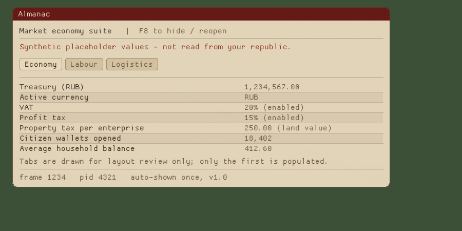

# almanac_overlay_dev — the Almanac ImGui panel

One panel, drawn with Dear ImGui, composited into the game's **own** back buffer
inside the game window. `F8` hides and reopens it. It is read-only and its values
are labelled placeholders.

```cmd
build.bat almanac_overlay_dev
```

Copy `build\plugins\almanac_overlay_dev.dll` and `almanac_overlay_dev.ini` into
the `plugins` folder of the runtime you are testing (the folder beside
`tesmioloader.dll`), then launch through Tesmio. Full check list in
[TESTING.md](TESTING.md).

This is a **new plugin**. The earlier `prototypes/almanac_overlay/native/` CMake
candidate is untouched and still not built by anything; `build.bat
almanac_overlay_dev` now builds this one.



This is the plugin's **actual ImGui draw list** rasterised offline over a flat
background — not a game screenshot, so the surrounding game view, DPI scaling and
font smoothing in your install will differ. The panel geometry is what the DLL
emits, so the layout and its size are the ones to expect.

---

## Why the panel never appeared before

Two independent blockers. Either one alone was enough to produce a log with no
panel and no error that pointed at the real cause.

### 1. The DLL was not in the loader's plugin folder

The ImGui panel lived in an isolated CMake target outside `plugins\`. Ordinary
`build.bat` discovers plugins by folder under `plugins\`, so it never produced
this DLL, and `build.bat` had no way to build it at all until a separate opt-in
target was added. The loader log from the Earthworks-panel test run lists
`almanac_button.dll` and seventeen other plugins, and no overlay DLL:

```
plugin   almanac_button   1.5      from almanac_button.dll
...
plugin   ui_overlay       1.0      from ui_overlay.dll
plugin   18 loaded
```

`LoadPlugins` in `src/tesmioloader.cpp` enumerates `<loader dir>\plugins\*.dll`.
A DLL that is not in that folder is never `LoadLibrary`'d, so `TsmPluginInit`
never runs, no hook is installed and no frame is drawn. There was nothing to
debug on the graphics side: from the loader's point of view the plugin did not
exist. This is the same failure the `docs/almanac-engineering-status.md` handoff
recorded — "the latest user log shows the DLL was absent from Tesmio's plugin
scan" — and it did not change by merging source.

### 2. When it *was* staged, its installer refused to run on the install

Even with the DLL present, `prototypes/almanac_overlay/native/dev_plugin.cpp`
declined unless **all** of the following matched:

| Gate | Required |
|---|---|
| `SOVIET64.exe` SHA-256 | `296644A9…6841B8` |
| `C3DDLL64.dll` SHA-256 | `65FCB684…231516` |
| engine call site RVA `0x148BC` | bytes `FF 15 8E 6E 15 00` |
| creation return address | engine RVA `0x148C2` exactly |
| window class | `Workers & Resources: Soviet Republic` |

Those are the identities of one specific game build (1.1.1.9 / 1.1.1.13 vintage).
Any other build — including whatever is installed on the machine that ran the
test — failed at the first check, `Init` returned non-zero, and the loader
unloaded the DLL:

```
plugin   "almanac_overlay_dev.dll" declined to install (1)
```

So `Present` was never hooked, and *nothing ever attempted to draw a frame*. The
absence of an ImGui error, a D3D11 error or a crash is expected: no drawing code
ran.

### Two secondary reasons the old design could not have recovered on its own

- **Startup ordering.** `TsmPluginStart` runs from `LoadPlugins`, which runs from
  `DllMain(DLL_PROCESS_ATTACH)`, i.e. under the loader lock. Doing graphics
  initialisation there is unsafe; waiting there is a deadlock. The old design
  needed an already-created game HWND at install time, which that phase cannot
  have.
- **No fallback.** The old installer only observed
  `D3D11CreateDeviceAndSwapChain`. If the engine had already created its device
  before injection, or another mod had already replaced that import, installation
  failed and there was nothing else to try.

### Why this plugin does not repeat any of that

| Old blocker | What this plugin does |
|---|---|
| Not in the build | Ordinary `plugins\almanac_overlay_dev\` folder built by name from `build.bat`, staged to `build\plugins` exactly like every other plugin |
| File-hash gate | Removed. Nothing is compared against a build identity; the chain is identified at runtime by its output window belonging to this process and being D3D11 |
| Engine RVA gate | Removed. The Present hook is reached through the engine's own d3d11 import, or through the shared DXGI vtable; no game address is involved |
| Loader-lock startup | `TsmPluginStart` only starts a worker thread; the hooks are installed there, and the first D3D11/ImGui call happens later, on the game's present thread |
| Single path, no fallback | Creation hook first; shared Present slot if that is unavailable or the device already existed |
| Unknowable failure | Every step logs under `almanac overlay`; see the check list below |

---

## What it does, precisely

- **Frame source.** `Present` on the game's swap chain, replaced through a chain
  adopted from the engine's own `D3D11CreateDeviceAndSwapChain` call. `Present`
  is called after our drawing with the original arguments and its result is
  returned unchanged.
- **Drawing.** A dedicated ImGui context, the DX11 backend, the default embedded
  font, and `GetBuffer(0)` each frame. The render-target binding is saved and
  restored around `ImGui_ImplDX11_RenderDrawData`; no reference to a back buffer
  survives a frame, so the game's own resize needs no interception.
- **Input.** One `GetAsyncKeyState` read per frame for the toggle key, turned into
  one edge per press. No Win32 input backend, no WndProc hook, no mouse or
  keyboard state fed to ImGui, and the panel carries
  `ImGuiWindowFlags_NoInputs`, so the game keeps every click and keypress.
- **Layout.** Content-sized, anchored top-left, `###`-suffixed window id so it is
  one window for the session. Fixed content height is computed from live style
  and font metrics — **deliberately not** `ImGuiWindowFlags_AlwaysAutoResize`,
  which reports no size on its first frame and therefore draws nothing.
- **Config.** `plugins\almanac_overlay_dev.ini`: `enabled`, `show_on_start`,
  `toggle_key`, `font_scale_percent`, `draw_when_unfocused`.
- **Coexistence.** The context is saved and restored around every use. It has no
  ImGui globals, no `imgui.ini` (`IniFilename = nullptr`) and no cursor changes.
  `F8` is also `ui_overlay`'s HUD key; both toggle on the same press, which is
  existing behaviour, not a new conflict.
- **No game access.** No RVA, no exported game function, no service `consume`,
  no read or write of game state, no save interaction.

### What it does not do

Interactive widgets, tabs that switch, live Finance/currency readout, typing,
mouse capture, a native sidebar entry, or device-loss recovery. `Present1` is not
hooked; a title-bar Close button is not drawn; the panel is hidden by `F8` only.

---

## Loading the pinned ImGui

`build.bat almanac_overlay_dev` compiles the plugin together with upstream Dear
ImGui **v1.91.9b** and its DX11 backend, with `/MT` like every other plugin.

- If `ALMANAC_IMGUI_DIR` is set, that checkout is used.
- Otherwise it clones the tag into `.cache\almanac-imgui-host-tests` (ignored by
  Git) once. No other dependency is fetched, and nothing is installed into the
  game.

ImGui is MIT (Omar Cornut and contributors). Its `LICENSE.txt` sits beside the
sources in the cache and must accompany any distributed binary. This plugin uses
only upstream ImGui and this directory's own code — no Earthworks/RepublicMP
GPL-derived source is linked in (that extraction stays in
`prototypes/almanac_overlay/earthworks/`).

## Source map

| File | Role |
|---|---|
| `almanac_overlay_dev.cpp` | Tesmio exports, INI, and the failure analysis in the file header |
| `graphics_hook.{h,cpp}` | installer thread, creation hook, Present hook, fallback, logging |
| `almanac_panel.{h,cpp}` | ImGui context + DX11 backend, per-frame render, target save/restore |
| `almanac_panel_view.{h,cpp}` | the panel itself: header, notice, tabs, table, footer |
| `overlay_toggle.h` | press-edge / eligibility policy, no OS calls |
| `almanac_version.h` | version string and ImGui pin |
| `almanac_overlay_dev.ini` | shipped configuration |
| `preview-host-render.png` | the panel as rasterised from the real draw list, offline |

## Host checks

```sh
python3 tests/almanac_overlay_dev/run_host_tests.py
python3 tests/almanac_overlay_dev/run_host_tests.py --imgui-dir .cache/almanac-imgui-host-tests
```

The first runs the toggle-policy checks only. The second also compiles the real
drawing source against ImGui and asserts it emits geometry at 1920x1080 and
640x480 and none at 0x0. Neither builds a DLL, touches a GPU or starts the game.
